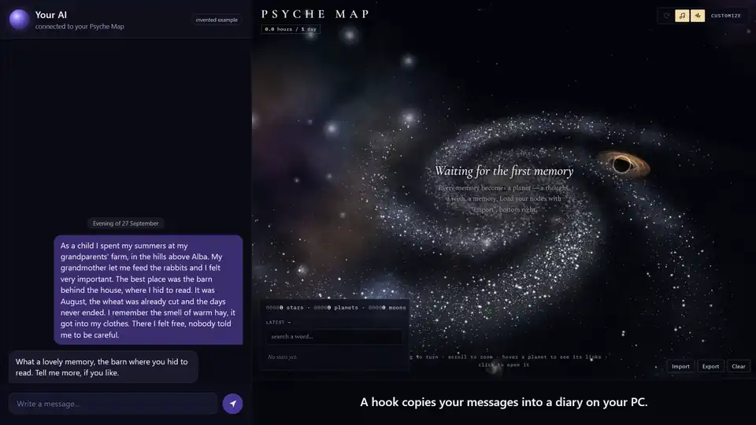
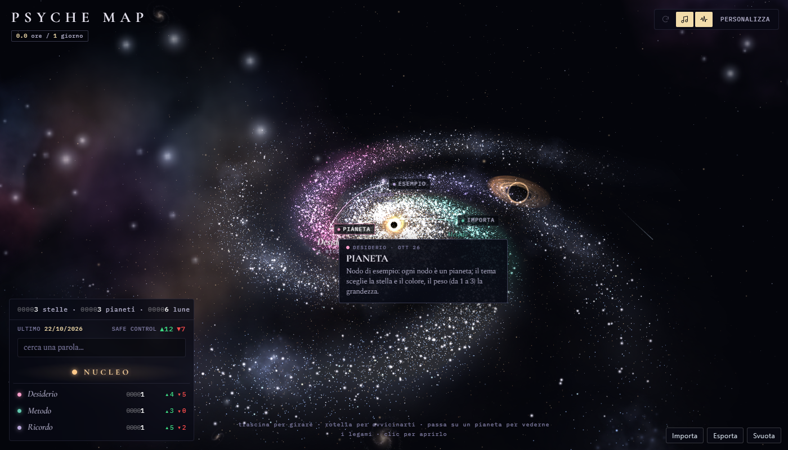

# Psyche Map

Una mappa 3D dei tuoi ricordi che cresce da sola mentre parli con la tua IA.

[](docs/psyche-map-video.mp4)

**Il video** ([docs/psyche-map-video.mp4](docs/psyche-map-video.mp4): in inglese, 2 min 16 s, con l'audio, circa
40 MB; GitHub lo scarica e lo guardi sul tuo PC): una persona inventata scrive alla sua IA per sei sere e la sua
mappa cresce da zero a 26 stelle, 26 pianeti e 130 lune. Alla fine: il nucleo, un ricordo visto da vicino e le sue
misure automatiche.

*English: [README.md](README.md)*

Psyche Map è un «secondo cervello» fatto per la vita interiore. Ogni ricordo che racconti alla tua IA finisce sulla
mappa: i temi della tua vita sono stelle, i ricordi sono pianeti che girano attorno, e i dettagli di ogni ricordo
sono lune. La tua IA legge la mappa prima di risponderti, così quando parli di qualcosa di personale sa già di
cosa parli.

Più parli con la tua IA, più ti conosce: in questo senso è una specie di supporto psicologico. Ma più che altro è
un gioco. Io non sono un esperto: l'ho costruito per passione dell'argomento.

Non è uno strumento per fare diagnosi e non sostituisce uno psicologo. Se qualcosa continua a farti male, parlane
con un professionista.

## Come funziona la mappa

La struttura segue il **Self-Memory System** di Conway e Pleydell-Pearce (2000), adattato:

| Sulla mappa | Nel modello di Conway | Cosa contiene |
|---|---|---|
| Nucleo | il sé che lavora | i tuoi scopi; per gioco, un'ipotesi su chi vorresti essere |
| Stelle | periodi della vita / temi | amore, famiglia, paura, lavoro... 26 temi, fissi: non si chiudono mai e possono ricrescere anni dopo |
| Pianeti | eventi generali | un ricordo o una situazione; due date: quando è successo e quando l'hai raccontato |
| Lune | dettagli specifici | un odore, una frase, un'immagine: i dettagli |

Un pianeta gira attorno a una stella; se appartiene anche a un altro tema, un filo sottile lo lega a quella
seconda stella.

**Si contano solo le lune**, perché un dettaglio è l'unica cosa che si può davvero risentire. Ogni luna ha due conti
separati, *come l'hai vissuta allora*: quanto positivo e quanto negativo, ognuno da 0 (per niente) a 4 (moltissimo).
Due conti e non un numero con il segno, perché un dettaglio può essere bello e doloroso insieme (Cacioppo e
Berntson, 1994; la griglia da 0 a 4 è quella di Larsen e altri, 2009). Quando torni su un ricordo, l'IA aggiunge una
rilettura *adesso*, così vedi come è cambiata la sensazione: di solito il negativo sbiadisce più in fretta del
positivo (il Fading Affect Bias). Pianeti, stelle e mappa intera sommano i conti delle loro lune, mai una media, e
dicono cosa prevale: il positivo, il negativo, tutti e due (ambivalente) o nessuno (neutro).

I conti li dà l'IA leggendo le tue parole: nessuno li mette a mano.

Ogni pianeta ha anche un **taccuino dello psicologo**: poche righe in terza persona su cosa è successo e cosa ha
lasciato, e i meccanismi psicologici riconosciuti che tocca (evitamento, rimuginio, perdita di fiducia...), ognuno
con quello che diventa quando è estremo e stabile e la fonte ufficiale (DSM-5-TR, ICD-11). Sono ipotesi per
capirti meglio, mai diagnosi: per un disturbo servono un clinico, più segni insieme, una durata precisa e un danno
vero alla vita di tutti i giorni.

Accanto al taccuino può esserci **la voce di un autore**: un autore vero, l'opera con l'anno e un'idea riassunta
dall'IA che aiuta a leggere il ricordo. Non è una citazione: se ti interessa, controlla l'opera.

Ogni pianeta ha poi alcune **misure automatiche**, anche queste mai messe a mano; il pannello mostra la fonte e il
limite di ognuna:

- **centralità**: quanto un ricordo pesa su chi sei. Conta i giorni in cui ne hai parlato, i legami con altri
  ricordi e le frasi di identità come «da allora» (Centrality of Event Scale, Berntsen e Rubin, 2006, adattata);
- **elaborazione**: quante parole di causa e di comprensione usi quando ne parli, e se crescono o calano dalla prima
  volta all'ultima (Pennebaker, 1997);
- **vividezza**: quanti dei dettagli raccontati sono vissuti e quanti sono commenti (Autobiographical Interview,
  Levine e altri, 2002). Li divide l'IA, il programma fa il conto;
- **tipo di ricordo**: un momento singolo, ripetuto o un periodo (Williams e Broadbent, 1986), e il suo ruolo,
  per esempio un inizio o una svolta (Pillemer, 2001);
- **tipi di dettaglio**: quanti dei cinque tipi (evento, luogo, tempo, sensi, emozioni) toccano le lune (Levine e
  altri, 2002);
- **significato**: le lezioni e le comprensioni che dici con parole tue (McLean e Thorne, 2003; Blagov e Singer,
  2004).

Il **nucleo**, il buco nero al centro, prova a indovinare **chi vorresti essere** partendo dai ricordi più centrali
(sé ideale: Higgins, 1987; sé possibili: Markus e Nurius, 1986). Ci prova solo quando ci sono almeno 20 ricordi su
almeno 3 stelle; prima dice «servono più dati». È un gioco, da non prendere sul serio: non è un test né una
diagnosi, e può sbagliare di molto.

## Come si collega alla tua IA

```
scrivi alla tua IA ──► hook ──► diario (sul tuo PC)
                         │
                         └──► i pianeti più vicini arrivano all'IA prima che risponda

ogni mattina ──► Claude Code legge il diario ──► pianeti, lune, conti, taccuino nuovi
                 controllo: ogni ricordo deve essere con le tue parole, altrimenti si butta
                 le frasi usate vanno in un archivio chiuso; le altre si cancellano
```

- **Basta Claude Code.** Un hook passa i pianeti più vicini prima di ogni risposta e scrive i tuoi messaggi nel
  diario; ogni mattina un'attività di Windows avvia `claude -p` per portare il diario sulla mappa.
- **Hermes Agent è facoltativo**: con lui arrivano sulla mappa anche i messaggi da Telegram e quelli a voce.
- **Niente invenzioni**: il testo di ogni pianeta e di ogni luna deve essere copiato dalle tue parole; il programma
  lo controlla e scarta quello che non lo è.
- **Privacy**: mappa, diario e archivio restano sul tuo PC, in una cartella che scegli tu. L'unica cosa che esce è
  quella che esce già quando usi un'IA: il lavoro del mattino manda il diario a Claude perché lo ordini. Il diario
  si può spegnere quando vuoi.

## Installazione

Servono Windows 10 o 11, Python 3.9 o più recente e Claude Code (con l'accesso fatto).

```
git clone https://github.com/Korvonordico/psyche-map
cd psyche-map
python collegamento/psyche.py installa --lingua it
```

Anche con Hermes: aggiungi `--hermes` (al primo avvio Hermes chiede il permesso per l'hook: rispondi sì).
Altre opzioni: `--cartella DIR` (dove sta la tua mappa, di base `~/Psyche`), `--ora 06:30` (il lavoro del mattino),
`--modello sonnet` (il modello di Claude per il lavoro del mattino; `opus` scrive taccuini migliori e costa di più).

Poi apri `~/Psyche/psyche-it.html` nel browser. Si aggiorna da sola ogni 15 secondi.

Per aggiornare: `git pull`, poi di nuovo il comando di installazione. La tua mappa e il tuo diario restano come sono.

## Come si usa la pagina



- Trascina per girare la vista, usa la rotellina per avvicinarti. Clicca una stella o un pianeta per aprire il suo
  pannello; passa sopra una luna per leggerla e cliccala per aprirla. Esc chiude.
- La casella di ricerca trova una parola nei pianeti e nelle lune.
- Personalizza (tasto G): colori, bagliore e velocità. Le modifiche restano in questo browser.
- Musica e rombo di fondo partono accesi: i due pulsanti in alto a destra, accanto a Personalizza, li spengono e li
  riaccendono. Il browser fa partire il suono solo dopo il primo clic sulla pagina.
- Quando arrivano ricordi o lune nuove, il pulsante «Aggiorna» (la freccia circolare in alto a destra) diventa rosso
  e lampeggia piano. Finché non lo tocchi le novità restano nascoste, anche nel contatore e anche se ricarichi la
  pagina. Quando lo tocchi le vedi nascere: un'esplosione accende una stella nuova, un pianeta viene catturato con un
  urto, le lune nuove nascono da un anello di detriti. La vista segue le nascite finché non tocchi la mappa; il
  pulsante del rombo spegne anche i loro suoni. Se apri la pagina per la prima volta con più di sei ricordi già
  dentro, o se il sistema chiede meno animazioni, compare tutto subito.
- Serve internet: la grafica 3D arriva da cdn.jsdelivr.net.

## Comandi

```
python collegamento/psyche.py stato             cosa c'è sulla mappa, cosa aspetta
python collegamento/psyche.py lavora            fa subito il lavoro del mattino
python collegamento/psyche.py cerca "parole"    i pianeti più vicini, con i dettagli
python collegamento/psyche.py spegni | accendi  ferma o riavvia la scrittura del diario
python collegamento/psyche.py disinstalla       toglie hook e attività; i tuoi dati restano
```

Vuoi solo guardare? Apri `psyche-it.html` da sola: mostra qualche esempio e tiene i dati nel browser (Importa ed
Esporta in basso a destra).

## Formato dei dati

Per chi scrive la mappa a mano o con un'altra IA. `psyche-dati.js`, accanto alla pagina, è questo JSON scritto come
`window.PSYCHE_FILE = {...};` (uno script e non un file `.json`, perché una pagina aperta dal disco non può leggere
i file JSON). Importa accetta lo stesso JSON.

```json
{
  "core": { "nucleo": { "label": "NUCLEO" } },
  "nodes": {
    "porto-2026-10-21": {
      "word": "PORTO", "theme": "infanzia", "temiAnche": ["famiglia"], "weight": 2,
      "text": "il ricordo, con le tue parole", "accadutoIl": "quando avevo otto anni",
      "createdAt": "2026-10-21T08:00:00+02:00", "linkedTo": [],
      "lune": [
        { "word": "MANO", "text": "un dettaglio", "pos": 3, "neg": 2,
          "adesso": [ { "data": "2026-11-02", "pos": 3, "neg": 0 } ] }
      ],
      "taccuino": ["poche righe in terza persona"],
      "meccanismi": [ { "nome": "evitamento", "testo": "cos'è e come si vede qui",
                        "estremo": "cosa diventa quando è estremo e stabile", "fonte": "DSM-5-TR, APA 2022" } ],
      "voce": { "autore": "John Bowlby", "opera": "Una base sicura, 1988", "idea": "un'idea riassunta, non una citazione" }
    }
  }
}
```

- `theme` è una delle 26 chiavi: identita, amore, metodo, relazione, creazione, famiglia, conflitto, solitudine,
  sostanza, ia, morte, sessualita, corpo, cura, infanzia, valore, denaro, casa, tempo, desiderio, lavoro, obiettivo,
  paura, ricordo, colpa, scoperta.
- `pos` e `neg` sono i due conti di una luna, da 0 a 4; `adesso` tiene le riletture fatte dopo, con gli stessi conti.
- `voce` è facoltativa; in `opera` va anche l'anno.
- L'ipotesi del nucleo (`ipotesi`, `basi`), `misure` e `menzioni` li scrive il lavoro del mattino: a mano non servono.
- I file vecchi, con `segno` e `forza` o con `valore` da -10 a +10, si leggono ancora: la pagina e il programma li
  trasformano da soli nei due conti.
- `accadutoIl` è quando è successo, a parole; `createdAt` è quando è stato scritto. `weight` va da 1 a 3.
- Tutti i campi tranne `word`, `theme` e `text` si possono lasciare fuori.

## Altri sistemi e altre IA

L'ho costruita e provata solo su quello che uso tutti i giorni: **Windows 11, Claude Code e Hermes Agent**. Non ho
esperienza diretta con altri sistemi o strumenti, quindi non posso farla funzionare lì da solo.

Se la vuoi su macOS o Linux, o con un'altra IA (Codex, Gemini CLI, Cursor, un modello locale...), **sei libero di
scaricare il codice, modificarlo e condividere la tua versione** (licenza MIT). Le parti da adattare sono piccole:
l'hook che legge i tuoi messaggi, il comando che fa il lavoro del mattino e l'avvio automatico. La mappa è un solo
file HTML che funziona in qualsiasi browser.

## Fonti

- Conway, M. A., e Pleydell-Pearce, C. W. (2000). The construction of autobiographical memories in the self-memory
  system. *Psychological Review*, 107(2), 261-288. https://pubmed.ncbi.nlm.nih.gov/10789197/
- Conway, M. A. (2005). Memory and the self. *Journal of Memory and Language*, 53(4), 594-628.
  https://doi.org/10.1016/j.jml.2005.08.005
- Russell, J. A. (1980). A circumplex model of affect. *Journal of Personality and Social Psychology*, 39(6),
  1161-1178. https://doi.org/10.1037/h0077714
- Bradley, M. M., e Lang, P. J. (1994). Measuring emotion: the Self-Assessment Manikin and the semantic
  differential. *Journal of Behavior Therapy and Experimental Psychiatry*, 25(1), 49-59.
  https://pubmed.ncbi.nlm.nih.gov/7962581/
- Skowronski, J. J., Walker, W. R., Henderson, D. X., e Bond, G. D. (2014). The Fading Affect Bias: its history,
  its implications, and its future. *Advances in Experimental Social Psychology*, 49, 163-218.
  https://doi.org/10.1016/B978-0-12-800052-6.00003-2
- Nolen-Hoeksema, S., Wisco, B. E., e Lyubomirsky, S. (2008). Rethinking rumination. *Perspectives on
  Psychological Science*, 3(5), 400-424. https://doi.org/10.1111/j.1745-6924.2008.00088.x
- Brown, N. R. (2016). Transition theory: a minimalist perspective on the organization of autobiographical memory.
  *Journal of Applied Research in Memory and Cognition*, 5(2), 128-134. https://doi.org/10.1016/j.jarmac.2016.03.005
  (un punto di vista diverso: i periodi nascono dai grandi cambiamenti della vita).
- American Psychiatric Association (2022). *DSM-5-TR*. https://www.psychiatry.org/psychiatrists/practice/dsm
- Organizzazione Mondiale della Sanità (2019). *ICD-11*. https://www.who.int/standards/classifications/classification-of-diseases

## Licenza

MIT: vedi [LICENSE](LICENSE).
