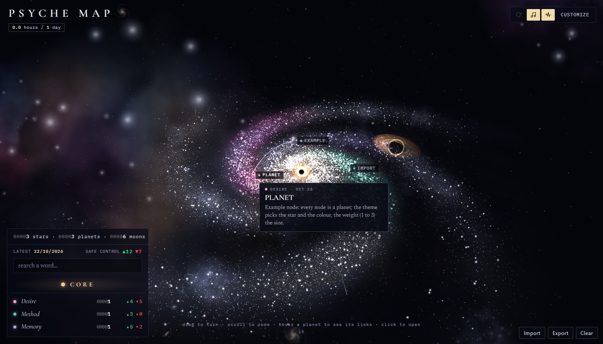

# Psyche Map

A 3D map of your memories that grows by itself while you talk with your AI.

[](docs/psyche-map-video.mp4)

**The video** ([docs/psyche-map-video.mp4](docs/psyche-map-video.mp4): 2 min 16 s, with sound, about 40 MB; GitHub
downloads it and you watch it on your PC): an invented person writes to her AI for six evenings and her map grows
from nothing to 26 stars, 26 planets and 130 moons. At the end: the core, one memory up close and its automatic
measures.

*Italiano: [LEGGIMI.md](LEGGIMI.md)*

Psyche Map is a second brain built for the inner life. Every memory you mention to your AI ends up on the map:
themes of your life are stars, memories are planets around them, and the details of each memory are moons. Your AI
reads the map before it answers, so when you talk about something personal it already knows what you mean.

The more you talk with your AI, the better it knows you: in that sense it is a kind of psychological support. But
above all it is a game. I am not an expert: I built it out of passion for the subject.

It is not a diagnostic tool. It does not replace a psychologist. If something keeps hurting, talk to a professional.

## How the map works

The structure follows the **Self-Memory System** by Conway and Pleydell-Pearce (2000), adapted:

| On the map | In Conway's model | What it holds |
|---|---|---|
| Core | working self | your goals; as a game, a guess at who you would like to be |
| Stars | lifetime periods / themes | love, family, fear, work... 26 themes, fixed: they never close and can grow again years later |
| Planets | general events | one memory or situation; two dates: when it happened and when you told it |
| Moons | event-specific knowledge | a smell, a sentence, an image: the details |

A planet orbits one star; if it also belongs to another theme, a thin thread links it to that second star.

**Only moons are counted**, because a detail is the only thing you can really feel again. Each moon has two
separate counts, *as you felt it then*: how positive and how negative, each from 0 (not at all) to 4 (extremely). Two
counts and not one signed number, because a detail can be lovely and painful at the same time (Cacioppo and
Berntson, 1994; the 0-4 grid is the one by Larsen and colleagues, 2009). When you come back to a memory later, the AI
adds a *now* re-reading, so you can see how the feeling changed: negative feelings usually fade faster than positive
ones (the Fading Affect Bias). Planets, stars and the whole map add up the counts of their moons, never an average,
and say what prevails: the positive, the negative, both (ambivalent) or neither (neutral).

The AI gives the counts by reading your words: nobody types them in.

Each planet also has a **psychologist's notebook**: a few lines in the third person about what happened and what it
left, and the recognised psychological mechanisms it touches (avoidance, rumination, loss of trust...), each with
what it becomes when it is extreme and lasting and the official source (DSM-5-TR, ICD-11). These are hypotheses
to help you understand yourself, never diagnoses: a disorder needs a clinician, several signs together, a set
duration and real harm to everyday life.

Next to the notebook there can be **an author's voice**: a real author, the work with its year and an idea summed up
by the AI that helps to read the memory. It is not a quotation: if it interests you, check the work.

Each planet then has some **automatic measures**, never typed in by hand either; the panel shows the source and the
limit of each:

- **centrality**: how much a memory weighs on who you are. It counts the days you talked about it, its links to
  other memories and identity phrases such as "ever since" (Centrality of Event Scale, Berntsen and Rubin, 2006,
  adapted);
- **elaboration**: how many words of cause and insight you use when you talk about it, and whether they grow or
  shrink from the first time to the last (Pennebaker, 1997);
- **vividness**: how many of the details you told are lived and how many are comments (Autobiographical Interview,
  Levine and colleagues, 2002). The AI sorts them, the program does the sum;
- **kind of memory**: a single moment, a repeated one or a period (Williams and Broadbent, 1986), and its role,
  for example a beginning or a turning point (Pillemer, 2001);
- **kinds of detail**: how many of the five kinds (event, place, time, senses, emotions) the moons touch (Levine
  and colleagues, 2002);
- **meaning**: the lessons and insights you put in your own words (McLean and Thorne, 2003; Blagov and Singer,
  2004).

The **core**, the black hole at the centre, tries to guess **who you would like to be** from your most central
memories (ideal self: Higgins, 1987; possible selves: Markus and Nurius, 1986). It only tries when there are at
least 20 memories on at least 3 stars; before that it says "more data needed". It is a game, not to be taken
seriously: it is not a test or a diagnosis, and it can be very wrong.

## How it connects to your AI

```
you write to your AI ──► hook ──► diary (on your PC)
                          │
                          └──► the closest planets go to the AI before it answers

every morning ──► Claude Code reads the diary ──► new planets, moons, counts, notebook
                  checks: every memory must be in your own words, or it is thrown away
                  used sentences go to a closed archive; the rest are deleted
```

- **Claude Code alone is enough.** A hook passes the closest planets before every answer and writes your messages
  to the diary; every morning a Windows task runs `claude -p` to bring the diary onto the map.
- **Hermes Agent is optional**: with it, your messages from Telegram and voice reach the map too.
- **Nothing is invented**: the text of every planet and moon must be copied from your words; the program checks it
  and drops anything that is not.
- **Privacy**: the map, the diary and the archive stay on your PC, in a folder of your choice. The only thing that
  leaves it is what already leaves it when you use an AI: the morning job sends the diary to Claude to sort it.
  You can switch the diary off at any time.

## Install

You need Windows 10 or 11, Python 3.9 or newer and Claude Code (logged in).

```
git clone https://github.com/Korvonordico/psyche-map
cd psyche-map
python collegamento/psyche.py install --language en
```

With Hermes too: add `--hermes` (on its first start Hermes asks you to allow the hook: answer yes).
Other options: `--folder DIR` (where your map lives, default `~/Psyche`), `--time 06:30` (the morning job),
`--model sonnet` (the Claude model for the morning job; `opus` writes better notebooks and costs more).

Then open `~/Psyche/psyche-en.html` in your browser. It updates by itself every 15 seconds.

To update: `git pull`, then run the install command again. Your map and your diary stay as they are.

## Using the page



- Drag to turn the view, scroll to zoom. Click a star or a planet to open its panel; hover a moon to read it and
  click it to open it. Esc closes.
- The search box finds a word in planets and moons.
- Customize (G key): colours, glow and speed. Your changes stay in this browser.
- Music and the background rumble start on: the two buttons at the top right, next to Customize, turn them off and
  on again. The browser starts sound only after your first click on the page.
- When new memories or moons arrive, the “Update” button (the circular arrow at the top right) turns red with a soft
  pulse. Until you press it the news stays hidden, in the counter too, even if you reload the page. Press it to watch
  them being born: a blast lights a new star, a planet is captured with an impact, new moons form from a ring of
  debris. The view follows the births until you touch the map; the rumble button turns their sounds off too. If you
  open the page for the first time with more than six memories already in it, or your system asks for less motion,
  everything appears at once.
- It needs internet: the 3D library comes from cdn.jsdelivr.net.

## Commands

```
python collegamento/psyche.py status            what is on the map, what is waiting
python collegamento/psyche.py work              run the morning job now
python collegamento/psyche.py search "words"    the closest planets, with details
python collegamento/psyche.py off | on          stop or restart writing the diary
python collegamento/psyche.py uninstall         removes hooks and task; your data stays
```

Just want to look? Open `psyche-en.html` on its own: it shows a few examples and keeps your data in the browser
(Import / Export at the bottom right).

## Data format

For those who write the map by hand or with another AI. `psyche-dati.js`, next to the page, is this JSON written as
`window.PSYCHE_FILE = {...};` (a script and not a `.json` file, because a page opened from disk cannot read JSON
files). Import accepts the same JSON.

```json
{
  "core": { "nucleo": { "label": "CORE" } },
  "nodes": {
    "harbour-2026-10-21": {
      "word": "HARBOUR", "theme": "infanzia", "temiAnche": ["famiglia"], "weight": 2,
      "text": "the memory, in your own words", "accadutoIl": "when I was eight",
      "createdAt": "2026-10-21T08:00:00+02:00", "linkedTo": [],
      "lune": [
        { "word": "HAND", "text": "a detail", "pos": 3, "neg": 2,
          "adesso": [ { "data": "2026-11-02", "pos": 3, "neg": 0 } ] }
      ],
      "taccuino": ["a few lines in the third person"],
      "meccanismi": [ { "nome": "avoidance", "testo": "what it is and how it shows here",
                        "estremo": "what it becomes when extreme and lasting", "fonte": "DSM-5-TR, APA 2022" } ],
      "voce": { "autore": "John Bowlby", "opera": "A Secure Base, 1988", "idea": "an idea summed up, not a quotation" }
    }
  }
}
```

- `theme` is one of 26 keys, always in Italian (the English page translates them): identita, amore, metodo,
  relazione, creazione, famiglia, conflitto, solitudine, sostanza, ia, morte, sessualita, corpo, cura, infanzia,
  valore, denaro, casa, tempo, desiderio, lavoro, obiettivo, paura, ricordo, colpa, scoperta.
- `pos` and `neg` are a moon's two counts, from 0 to 4; `adesso` (now) holds the later re-readings, with the same
  counts.
- `voce` (voice) is optional; `opera` (work) includes the year.
- The core's guess (`ipotesi`, `basi`), `misure` and `menzioni` are written by the morning job: no need to write them
  by hand.
- Old files, with `segno` and `forza` or with `valore` from -10 to +10, still load: the page and the program turn
  them into the two counts by themselves.
- `accadutoIl` is when it happened, in words; `createdAt` is when it was written. `weight` goes from 1 to 3.
- Every field except `word`, `theme` and `text` can be left out.

## Other systems and other AIs

I built and tested this only on what I use every day: **Windows 11, Claude Code and Hermes Agent**. I have no
direct experience with other systems or tools, so I can't make it work there myself.

If you want it on macOS or Linux, or with another AI (Codex, Gemini CLI, Cursor, a local model...), **you are free
to download the code, change it and share your version** (for noncommercial use, see Licence). The pieces to adapt are small: the hook
that reads your messages, the command that runs the morning job, and the scheduler. The map itself is a single
HTML file that works in any browser.

## Sources

- Conway, M. A., and Pleydell-Pearce, C. W. (2000). The construction of autobiographical memories in the self-memory
  system. *Psychological Review*, 107(2), 261-288. https://pubmed.ncbi.nlm.nih.gov/10789197/
- Conway, M. A. (2005). Memory and the self. *Journal of Memory and Language*, 53(4), 594-628.
  https://doi.org/10.1016/j.jml.2005.08.005
- Russell, J. A. (1980). A circumplex model of affect. *Journal of Personality and Social Psychology*, 39(6),
  1161-1178. https://doi.org/10.1037/h0077714
- Bradley, M. M., and Lang, P. J. (1994). Measuring emotion: the Self-Assessment Manikin and the semantic
  differential. *Journal of Behavior Therapy and Experimental Psychiatry*, 25(1), 49-59.
  https://pubmed.ncbi.nlm.nih.gov/7962581/
- Skowronski, J. J., Walker, W. R., Henderson, D. X., and Bond, G. D. (2014). The Fading Affect Bias: its history,
  its implications, and its future. *Advances in Experimental Social Psychology*, 49, 163-218.
  https://doi.org/10.1016/B978-0-12-800052-6.00003-2
- Nolen-Hoeksema, S., Wisco, B. E., and Lyubomirsky, S. (2008). Rethinking rumination. *Perspectives on
  Psychological Science*, 3(5), 400-424. https://doi.org/10.1111/j.1745-6924.2008.00088.x
- Brown, N. R. (2016). Transition theory: a minimalist perspective on the organization of autobiographical memory.
  *Journal of Applied Research in Memory and Cognition*, 5(2), 128-134. https://doi.org/10.1016/j.jarmac.2016.03.005
  (a different view: periods are shaped by big life transitions).
- American Psychiatric Association (2022). *DSM-5-TR*. https://www.psychiatry.org/psychiatrists/practice/dsm
- World Health Organization (2019). *ICD-11*. https://www.who.int/standards/classifications/classification-of-diseases

## Licence

PolyForm Noncommercial 1.0.0: see [LICENSE](LICENSE). You can use, change and share it for free for any
noncommercial purpose (personal use, study, research, hobby, charities, schools). Any commercial use needs my
permission: ask me on GitHub. Versions published earlier under the MIT licence keep it.
